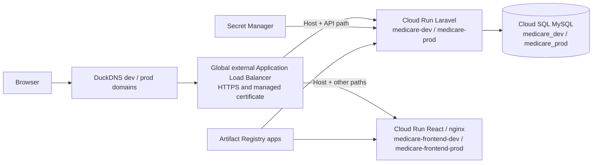

# MediCare Health Group

A medical benefits platform for a Third Party Administrator, with separate React and Laravel applications. Employees access their own medical records, HR manages employees within its company, and Helpdesk processes submissions across client companies.

## Live demo

| Environment | URL | Purpose |
| --- | --- | --- |
| Dev | [medicare-dev.duckdns.org](https://medicare-dev.duckdns.org) | Validate changes before release |
| Prod | [medicare-prod.duckdns.org](https://medicare-prod.duckdns.org) | Stable public demonstration |

Both environments contain fictional sample accounts. The shared demonstration password is `LearningDemo!2026`.

| Account | Email | Role | Company |
| --- | --- | --- | --- |
| Alex Chen | `alex@microprogram.employee` | Employee | Microprogram |
| Jamie Lee | `jamie@horizon.employee` | Employee | Horizon |
| Morgan Lin | `morgan@microprogram.hr` | HR | Microprogram |
| Riley Tan | `riley@horizon.hr` | HR | Horizon |
| Taylor Wong | `taylor@medicare.helpdesk` | Helpdesk | MediCare, the TPA operator |

Demo submissions and reviews write to the selected environment's database. Dev and prod data are independent; changes to sample records are not copied between them.

## Architecture

```text
frontend_react/    React + TypeScript + Vite + MUI
backend_laravel/   Laravel 13 + MySQL + JWT API
backend_laravel/docker/  PHP-FPM, nginx and Supervisor configuration
docs/              Product requirements and technical documentation
compose.yaml      Local MySQL, Redis, migration and nginx/PHP-FPM services
.gitlab-ci.yml    Checks, image publishing and Cloud Run deployments
```

The React frontend consumes the Laravel JWT API. Controllers coordinate HTTP requests, FormRequests validate input and authorization, and Services handle business operations and scoped queries. MySQL stores company, benefit, visit and medication records.

### Relationship loading

Eloquent models define the one-to-many relationship between visits and medications. Employee and HR visit lists use `with('medications')` to eager load medication records. The Helpdesk pending list uses `with(['user.company', 'medications'])` to also load each employee and company.

Eloquent retrieves the visits, fetches related records in batches, and matches them to their parent models using foreign keys. This avoids a separate medication query for every visit when reading the loaded relationships. See [Employee visits](backend_laravel/app/Services/VisitService.php), [HR employee visits](backend_laravel/app/Services/HrEmployeeService.php) and [Helpdesk pending visits](backend_laravel/app/Services/HelpdeskVisitService.php). This describes the implemented query strategy; query-count and performance measurements have not been recorded.

### Local Redis cache

The HR benefit-plan list uses cache-aside through Predis when `BENEFIT_PLANS_CACHE_STORE=redis`. Role and company checks run before cache access. Keys include the application environment and company ID; plain-array results expire after 300 seconds. Plan changes can remain cached until expiration unless the corresponding key is explicitly cleared.

Docker Compose runs Redis as a separate service and enables this cache locally. The default cache store remains `database`. When the feature setting is absent, the service queries MySQL directly. Predis connection and stream-initialization failures are reported, then the service falls back to MySQL. Redis failures can still delay the response while the connection attempt completes.

Manual local verification confirmed one SQL query on a cache miss, zero SQL queries on the next cache hit, and identical returned data. These counts cover the benefit-plan Service call, not authentication or the full page. The cache key's TTL decreased as expected, and the HR page remained usable with Redis stopped and after it restarted. These are manual checks, not automated cache test coverage.

Redis is not configured in the cloud environments. Benefit balances and the Helpdesk pending list continue to query the database directly.

## Project documentation

[Product requirements](docs/PRD.md) define users, workflows and acceptance criteria. [System requirements](docs/SRS.md) document API contracts, authorization and validation. The [ERD and data dictionary](docs/ERD.md) describe database relationships and constraints. The `backend_laravel/docker` directory contains PHP-FPM, nginx and Supervisor configuration used by the backend Dockerfile. The root `.gitlab-ci.yml` defines validation, image publishing and Cloud Run deployments.

## Features

- Email/password login returns a JWT as `access_token`.
- Sign out captures the JWT, clears the browser session, then revokes the captured JWT through Laravel. A failed revocation is reported on the login page.
- `/api/me` restores the authenticated user's profile and role.
- Employee overview displays annual benefits, personal visits and medications.
- HR manages own-company employees, reviews visits/medications and assigns the current-year benefit plan.
- HR can retrieve a current-year company medical spending summary through the API and Swagger.
- Helpdesk reviews pending visits across client companies and approves or rejects submissions.
- React forms submit visits, assign benefit plans and review submissions through protected APIs.
- Visits support diagnosis, sick leave dates, visit time, doctor details and multiple medications.
- Visit records support ascending and descending sorting.
- React provides browser pages; Laravel exposes the application API.
- JWT persistence uses localStorage.
- Controllers coordinate HTTP responses, FormRequests validate input/roles, and Services handle scoped queries and business operations.
- Swagger documents the application APIs, with email login and JWT Bearer authorization.

Only approved visits count toward annual usage. Medication costs are included in visit covered amounts and are not deducted twice. Each employee has one plan assignment per calendar year; changing plans preserves that year's usage. Display/input use whole TWD and storage uses integer cents.

### HR annual medical spending summary

`GET /api/hr/summary` requires a valid JWT and an HR account with company membership. The company scope comes from the authenticated HR account; the endpoint does not accept a company ID. The optional `year` query parameter accepts an integer from 2000 to the current year and defaults to the current year when omitted. Invalid years return HTTP 422 through `HrSummaryRequest` validation.

The response contains:

| Field | Meaning |
| --- | --- |
| `year` | Selected calendar year; defaults to the current year |
| `currency` | `TWD` |
| `employee_count` | Current number of employees in the HR account's company, excluding HR and Helpdesk accounts |
| `approved_visit_count` | Number of approved visits in that year belonging to the company's current employees |
| `used_amount` | Total coverage of those approved visits, expressed in whole TWD |

The Service scopes visits through their employee relationship and performs `COUNT` and `SUM` in the database. Pending and rejected visits are excluded; medication amounts are already included in visit coverage and are not added again. A company with no matching approved visits receives zero visit count and spending. This is a summary based on current company membership, not a historical employee headcount report.

The endpoint is available through the API and Swagger; a React summary dashboard is not implemented. Use `/api/hr/summary` for the current year or `/api/hr/summary?year=2025` for a selected year. Employee count always reflects current company membership, regardless of the selected year.

Local manual Swagger checks confirmed the current-year summary, a 2025 response with zero visits and spending for an empty reporting year, and an HTTP 422 response for a future year (2027 when the current year was 2026). Values change as demonstration records are reviewed or added.

## Local development

Requirements: Docker Engine and Compose, Node 24 and pnpm as pinned in the frontend manifest. The host backend `.env` remains independent; Compose injects its own database and keys into the containers.

Run commands from the repository root. Keep the ignored `.env.docker` with `APP_KEY`, `JWT_SECRET`, `DB_PASSWORD` and `MYSQL_ROOT_PASSWORD`. Do not regenerate existing keys or print resolved Compose configuration.

```bash
# Build the dev stage, not the final production stage.
docker build --target dev -t medicare-backend:dev ./backend_laravel
```

For a fresh checkout only, generate `.env.docker` if it does not exist:

```bash
if [ ! -e .env.docker ]; then
  docker run --rm --entrypoint php medicare-backend:dev -r '
  echo "APP_KEY=base64:".base64_encode(random_bytes(32)).PHP_EOL;
  echo "JWT_SECRET=".bin2hex(random_bytes(32)).PHP_EOL;
  echo "DB_PASSWORD=".bin2hex(random_bytes(24)).PHP_EOL;
  echo "MYSQL_ROOT_PASSWORD=".bin2hex(random_bytes(24)).PHP_EOL;
  ' > .env.docker
fi
```

Install backend dependencies into the mounted project directory before starting services:

```bash
docker compose --env-file .env.docker run --rm --no-deps backend composer install --no-interaction --prefer-dist
docker compose --env-file .env.docker config --quiet
docker compose --env-file .env.docker up -d --build --remove-orphans
docker compose --env-file .env.docker ps -a
```

Compose starts MySQL, waits for its health check, runs the one-shot migration service, then starts the backend after migration succeeds. Local initialization also runs repeatable sample seeders. Deployment migrations do not run sample seeders; cloud demo data was initialized explicitly in each environment. A migration failure blocks backend startup; inspect it with `docker compose --env-file .env.docker logs migration`.

nginx listens inside the backend container on port 8080, serves public files and forwards Laravel requests to PHP-FPM through a Unix socket. Supervisor manages both processes. Backend source and vendor are bind-mounted at `/var/www`, so source changes do not require image rebuilds. Runtime/Dockerfile changes do require rebuilding.

In another terminal, run Vite on the Mac:

```bash
cd frontend_react
pnpm install --frozen-lockfile
pnpm dev
```

Open http://127.0.0.1:5174. Vite forwards `/api` and `/docs` to http://127.0.0.1:8003. Swagger UI is available at http://127.0.0.1:5174/api/doc; it loads its OpenAPI document through `/docs`. Vite runs on the host rather than as a Compose service.

MySQL uses `medicare_docker` inside the Compose network. The `mysql_data` volume persists database records across container restarts.

```bash
# Stop while preserving the database volume.
docker compose --env-file .env.docker down
# Restart; the initialization job runs before the backend.
docker compose --env-file .env.docker up -d
```

`down -v` deletes the database volume. Do not use it for ordinary restarts.

### Optional demonstration activity

After the base accounts and benefit plans have been seeded, explicitly run:

```bash
docker compose --env-file .env.docker exec backend php artisan db:seed --class=DemoActivitySeeder
```

On a fresh database, this creates eight employees per client company, two HR accounts in total, 64 visits and 64 medication records. Each employee has two approved visits, one pending visit and one rejected visit, with varied dates and amounts, doctor details and a sick-leave example. All medical information is fictional. New accounts use the shared demonstration password listed above; existing passwords are preserved.

The visit fixtures use fixed 2026 dates, while employee plan assignments use the current year. Review the fixture year before reusing this dataset in later years. Repeated runs preserve matching visits, their review decisions, existing medications and annual plan choices. Visits are matched by employee, clinic, date and time; changing those fixture identifiers would create additional records. Existing manual data is retained, so an already-used database may have different totals and status counts.

This seeder is not called by `DatabaseSeeder` or deployment migrations. Import the data separately in each environment only after the updated application image has been deployed. It does not copy data between environments.

## Production image

```bash
docker build --target prod -t medicare-backend:prod ./backend_laravel
```

The same Dockerfile provides runtime, dev, build and prod stages. The build stage installs dependencies without dev packages and caches routes/views. The final stage contains nginx, PHP-FPM and application code, without Composer or Xdebug. The build context is `backend_laravel/`; its `.dockerignore` excludes local credentials, dependencies, generated files and smoke fixtures. The startup hook caches configuration from runtime environment variables in production and skips optimization locally.

Runtime configuration lives in `backend_laravel/docker/{nginx,php,supervisor}` with a shared `entrypoint.sh`. There is one backend Dockerfile and no separately published custom base image. The `runtime` stage starts from the official PHP image; `dev`, `build` and `prod` derive from that stage.

Run the runtime smoke checks from the repository root:

```bash
backend_laravel/docker/test/smoke.sh prod
backend_laravel/docker/test/smoke.sh dev
```

Each check builds the corresponding backend target and starts a temporary container on a dynamically allocated localhost port. An isolated PHP fixture and startup hook replace the application for checks of nginx routing, FPM settings, extensions, Supervisor restart behavior and logs. Containers are removed on exit; the development database is not used. Set `PLATFORM=linux/amd64` to check the Cloud Run architecture on Apple Silicon.

The production migration command uses the same application image with a separate job:

```bash
sh /var/www/db-migrate-seed.sh
```

## GCP deployment

The application is deployed in project `medicare-19980309`, with Cloud Run, Cloud SQL and Artifact Registry in `asia-east1` (Taiwan). The load balancer is a global external Application Load Balancer.



| Resource | Configuration |
| --- | --- |
| Load balancer | `medicare-lb`, reserved IPv4 `136.110.151.54`, HTTPS port 443, HTTP-to-HTTPS redirect |
| TLS certificate | Google-managed `medicare-cert`, covering both DuckDNS domains |
| Container registry | `asia-east1-docker.pkg.dev/medicare-19980309/apps`, backend and frontend images tagged with the full Git commit SHA |
| Database | Cloud SQL `medicare-mysql`, MySQL 8.4, separate `medicare_dev` and `medicare_prod` databases and database users |
| Backend identity | `backend-runtime`, with Cloud SQL Client and access to the relevant Secret Manager secrets |
| Frontend identity | `frontend-runtime` |
| Runtime secrets | Separate database passwords, Laravel application keys and JWT secrets for dev and prod |
| Cloud Run services | Request-based billing, minimum 0 and maximum 1 instance per service, 1 CPU and 512 MiB memory |
| Ingress | Internal + Load Balancing for all four services; external requests use the load balancer |
| Optional services | Cloud CDN disabled; no Cloud Armor policies configured |

The backend connects through the Cloud SQL Unix socket using its runtime service account. Secret values are supplied by Secret Manager, not embedded in images. Each backend has its own `APP_URL` set to its environment's HTTPS domain. React uses same-origin `/api` requests.

Routing first selects the environment by hostname, then selects the application by path:

| Host | Paths | Backend service | Cloud Run service |
| --- | --- | --- | --- |
| `medicare-dev.duckdns.org` | `/api`, `/api/*`, `/docs`, `/docs/*`, `/up` | `medicare-dev-backend` | `medicare-dev` |
| `medicare-dev.duckdns.org` | All other paths | `medicare-dev-frontend` | `medicare-frontend-dev` |
| `medicare-prod.duckdns.org` | `/api`, `/api/*`, `/docs`, `/docs/*`, `/up` | `medicare-prod-backend` | `medicare-prod` |
| `medicare-prod.duckdns.org` | All other paths | `medicare-prod-frontend` | `medicare-frontend-prod` |

Each backend service uses a serverless network endpoint group pointing to its Cloud Run service. Unmatched hosts use `medicare-prod-frontend` as the global default.

### Migration jobs

`medicare-dev-migration-job` and `medicare-prod-migration-job` use the backend image and their respective database settings. Each runs one task, with a five-minute timeout and zero retries.

The container command is `/bin/sh`, and its argument is `/var/www/db-migrate-seed.sh`. The shell executes the script, which runs `php artisan migrate --force` as `www-data`, then exits. Laravel tracks completed migrations, so later deployments execute only pending migrations.

Both cloud environments use `APP_ENV=production` and `APP_DEBUG=false`. The script seeds automatically only when `APP_ENV=local`; dev/prod demo accounts were initialized separately with `php /var/www/artisan db:seed --force`. Ordinary deployment does not reset demo records.

### CI/CD release workflow

```text
Feature branch push -> checks and image build validation
Protected main push / merge -> automatic image publishing -> automatic dev deployment
Verify dev -> manually run prod-deploy in the same pipeline -> production release
```

The pipeline runs frontend lint/build, backend PHP syntax checks, Composer validation, backend tests and secret detection. Image publishing and deployment jobs run only on protected `main`.

`backend-image-publish` and `frontend-image-publish` build and push commit-tagged images. `dev-deploy` waits for both publish jobs, updates and executes the dev migration job, waits for it to succeed, then updates the backend and frontend services. A migration failure stops the remaining deployment commands.

`prod-deploy` waits for that pipeline's dev deployment and requires a manual action. It uses the same commit-tagged images, runs the prod migration job, then updates the prod backend and frontend. Promotion does not rebuild the images or copy the dev database. Deployments are serialized separately for dev and prod with GitLab `resource_group`.

CI authenticates as `gitlab-ci` using the protected, masked and hidden `GCP_SERVICE_ACCOUNT_KEY` GitLab variable. The Base64-encoded credential is decoded into a temporary file for deployment and removed when the job exits. CI has Artifact Registry Writer on `apps`, Cloud Run Developer on the four services and two migration jobs, and Service Account User on both runtime service accounts.

To release a tested version, open its `main` pipeline in GitLab, verify `dev-deploy` succeeded, exercise the dev website, then run `prod-deploy`. Until production release is triggered, the pipeline can show **Blocked** because it is waiting for the manual job.

## Validation

```bash
cd frontend_react
pnpm lint
pnpm build
```

Run backend tests with `cd backend_laravel && php artisan test`. Tests retain SQLite in memory. The root GitLab pipeline runs these checks before publishing and deploying on protected `main`.

Runtime checks:

```bash
curl -fsS http://127.0.0.1:8003/ping
curl -fsS http://127.0.0.1:8003/up
docker compose --env-file .env.docker exec backend supervisorctl status
```

Verify login, Employee submission, HR visibility and Helpdesk approval through React. Medication amounts must remain included in visit coverage rather than deducted twice. The API uses Controller/Service/FormRequest separation and is documented with Swagger.

### Cloud validation checkpoint — 2026-10-14

[Pipeline #2946658940](https://gitlab.com/woizhicheng0309/medicare/-/pipelines/2946658940), for commit `30a2ccecea619c595f87a468bb6fe27a28902fb8`, passed all 11 jobs, including automatic dev deployment and manual prod deployment.

The following deployment checks were completed:

- Dev and prod HTTPS homepages and `/up` endpoints returned HTTP 200 after release.
- Direct `run.app` access returned HTTP 404 after ingress was restricted.
- Employee, HR and Helpdesk accounts logged in successfully in dev; prod sample login was also verified.
- An Employee submitted a TWD 600 Central Clinic visit in dev. After approval, annual usage was TWD 600 and the remaining Plus balance was TWD 17,400.
- HR saw Alex's approved visit within Microprogram and did not see Horizon employee Jamie in its employee list.
- After CI/CD deployment, dev retained the approved visit and balance; prod retained its separate initial TWD 18,000 balance.

These are manual cloud smoke checks, separate from the automated backend test suite. Demo records can change as visitors exercise the application.

## API documentation

Open http://127.0.0.1:5174/api/doc through Vite, or http://127.0.0.1:8003/api/doc directly. The JSON specification is served at `/docs`. It is generated on the first specification request and then reused. Edit `backend_laravel/app/OpenApi/ApiDocumentation.php` when changing an API contract, then regenerate:

```bash
docker compose --env-file .env.docker exec backend php artisan l5-swagger:generate
```

Use the login operation with your development credentials, copy its `access_token` into Swagger's Authorize dialog, and try protected endpoints. Authorization storage in Swagger is disabled by default; credentials and real tokens are not embedded in the specification. Write operations change the connected database, including visit submission and review.

API documentation uses L5 Swagger with PHP attributes for API definitions and JWT Bearer authorization. Swagger UI is served by Laravel; React provides the application pages.

Trace a submission: `StoreVisitRequest` validates employee access and input, `VisitController` calls `VisitService`, and the service saves the visit/medications in one transaction through their Models. The Controller returns the JSON response. Review follows the same separation and retains row locking, pending-status checks and server-generated audit fields.

## Planned improvements

Extend cache verification to company isolation and expiration-driven refresh, add automated regression coverage, and configure bounded Redis connection/read timeouts. Evaluate Redis hosting and network access separately before enabling caching in cloud environments.
