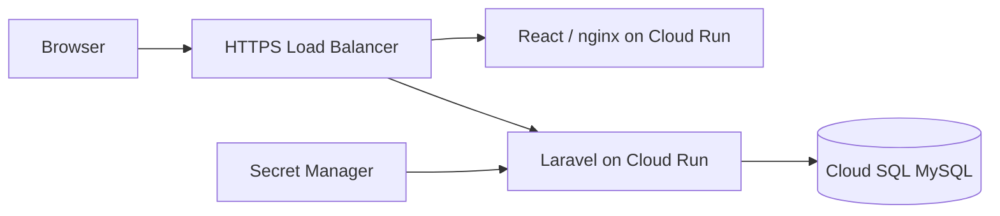

# MediCare Health Group

MediCare is a medical benefits platform for a Third Party Administrator (TPA). Employees submit and review their medical visits, client-company HR manages benefits and reporting, and the TPA Helpdesk reviews submissions across companies.

## Live demo

| Environment | URL | Purpose |
| --- | --- | --- |
| Production | [medicare-prod.duckdns.org](https://medicare-prod.duckdns.org) | Public demonstration |
| Development | [medicare-dev.duckdns.org](https://medicare-dev.duckdns.org) | Validate changes before release |

All accounts and medical records are fictional.

> [!IMPORTANT]
> **Demo password for all accounts: `LearningDemo!2026`**

| Role | Name | Email | Company |
| --- | --- | --- | --- |
| Employee | Alex Chen | `alex@microprogram.employee` | Microprogram |
| Employee | Jamie Lee | `jamie@horizon.employee` | Horizon |
| HR | Morgan Lin | `morgan@microprogram.hr` | Microprogram |
| HR | Riley Tan | `riley@horizon.hr` | Horizon |
| Helpdesk | Taylor Wong | `taylor@medicare.helpdesk` | MediCare (TPA) |

Submissions and reviews modify the selected environment's sample data. Development and production use separate databases.

## Features

- **Employee:** View benefit usage, submit visits and see personal visit and medication records.
- **HR:** View employees and medical records within the HR account's company, assign annual benefit plans, and access company spending and clinic statistics through the API.
- **Helpdesk:** Review pending visits across client companies and approve or reject submissions.

Only approved visits count toward annual benefit usage. Medication coverage is included in the visit amount and is not deducted twice. Amounts are entered and displayed in whole TWD; the database stores integer cents.

## Architecture

- **Frontend:** React, TypeScript, Vite and Material UI.
- **Backend:** PHP, Laravel, MySQL and JWT authentication. Controllers handle requests, FormRequests validate input, and Services contain business operations and scoped queries.
- **Data access:** Eloquent relationships and eager loading retrieve visits and their medications without a separate medication query for each visit.
- **Deployment:** Docker, GitLab CI/CD, Cloud Run, Cloud SQL, Artifact Registry and Secret Manager.
- **API:** Swagger UI documents and exercises the Employee, HR and Helpdesk endpoints.



## Local development

Requirements: Docker with Compose, Node.js 24 or later, and pnpm as specified in `frontend_react/package.json`.

From the repository root, build the development image and create `.env.docker` for a fresh checkout. The condition preserves an existing file and its keys.

```bash
docker build --target dev -t medicare-backend:dev ./backend_laravel

if [ ! -e .env.docker ]; then
  docker run --rm --entrypoint php medicare-backend:dev -r '
  echo "APP_KEY=base64:".base64_encode(random_bytes(32)).PHP_EOL;
  echo "JWT_SECRET=".bin2hex(random_bytes(32)).PHP_EOL;
  echo "DB_PASSWORD=".bin2hex(random_bytes(24)).PHP_EOL;
  echo "MYSQL_ROOT_PASSWORD=".bin2hex(random_bytes(24)).PHP_EOL;
  ' > .env.docker
fi
```

Install backend dependencies and start the local services:

```bash
docker compose --env-file .env.docker run --rm --no-deps backend composer install --no-interaction --prefer-dist
docker compose --env-file .env.docker up -d --build
```

Compose waits for MySQL, then runs migrations and the base sample seeders before starting the backend. For migration errors, inspect `docker compose --env-file .env.docker logs migration`.

In another terminal, start the frontend:

```bash
cd frontend_react
pnpm install --frozen-lockfile
pnpm dev
```

Open [http://127.0.0.1:5174](http://127.0.0.1:5174). Local Swagger UI is available at [http://127.0.0.1:5174/api/doc](http://127.0.0.1:5174/api/doc).

To add more fictional visits after initial setup:

```bash
docker compose --env-file .env.docker exec backend php artisan db:seed --class=DemoActivitySeeder
```

The activity seeder is optional and is not run during deployment. Its visit dates are fixed in 2026; review the fixture year before using it in a later year. Existing records are preserved, so totals can differ on an already-used database.

Use `docker compose --env-file .env.docker down` to stop the services while preserving the database volume. Adding `-v` deletes that volume and its data.

## GCP deployment

Development and production run separately on Cloud Run and Cloud SQL. GitLab CI validates changes and builds commit-tagged images. On protected `main`, the pipeline publishes images and runs the development migration Job before updating the services. After development verification, a manual job promotes the same images to production and runs its migration Job.

The backend's application image contains PHP-FPM, nginx and Supervisor. The migration Job uses the same backend image and executes the migration script as a separate task.

## Validation

```bash
cd frontend_react
pnpm lint
pnpm build
```

Run backend tests with `cd backend_laravel && php artisan test`. GitLab CI also runs the project checks before deployment.

## API and project documentation

- [Production Swagger UI](https://medicare-prod.duckdns.org/api/doc) · [Development Swagger UI](https://medicare-dev.duckdns.org/api/doc)
- [Product requirements (PRD)](https://gitlab.com/woizhicheng0309/medicare/-/blob/main/docs/PRD.md)
- [System requirements (SRS)](https://gitlab.com/woizhicheng0309/medicare/-/blob/main/docs/SRS.md)
- [Entity relationship diagram and data dictionary](https://gitlab.com/woizhicheng0309/medicare/-/blob/main/docs/ERD.md)
- [PHP2SHELL security response](https://gitlab.com/woizhicheng0309/medicare/-/blob/main/docs/security/2026-10-21-php2shell-response.md)

For protected API operations, use the Swagger login endpoint and enter the returned `access_token` in **Authorize**. HR spending and clinic statistics are available through the API and Swagger; a React reporting dashboard is not currently implemented.
