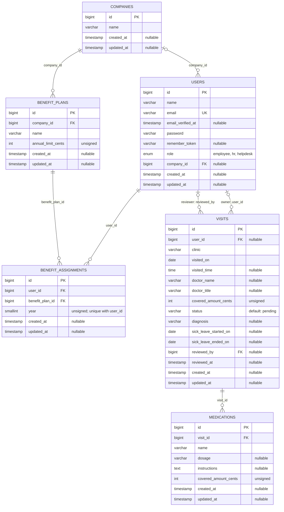

# Entity Relationship Diagram and Data Dictionary

MediCare Health Group stores client companies, application users, annual benefit assignments, clinic visits, and medication breakdowns. This document describes the final schema produced by the current Laravel migrations, with MySQL as the deployment database.

Related documents: [Product requirements](PRD.md), [System requirements](SRS.md), [Project overview](../README.md).

## Domain relationships

The diagram shows database optionality. Application requests impose additional rules described below. Each parent can have zero or more children. A user may have no company; a visit may have no owner or reviewer at the database level. Each plan, assignment, and medication must reference its required parent records.

## Data dictionary

All domain `id` columns are auto-incrementing `BIGINT UNSIGNED` primary keys. All domain foreign keys are `BIGINT UNSIGNED`. Unless marked nullable, a field is required at the database level. Laravel `timestamps()` creates nullable `created_at` and `updated_at` timestamp columns on all six domain tables.

### companies

| Column | MySQL type | Constraint / meaning |
|---|---|---|
| `id` | BIGINT UNSIGNED | Primary key |
| `name` | VARCHAR(255) | Organization name; not unique |
| `created_at`, `updated_at` | TIMESTAMP | Nullable record timestamps |

The seed data contains the operator, MediCare, and two client companies, Microprogram and Horizon. Helpdesk is an internal operator role; the seeded Helpdesk user belongs to MediCare. A company row does not itself grant application permissions.

### users

| Column | MySQL type | Constraint / meaning |
|---|---|---|
| `id` | BIGINT UNSIGNED | Primary key |
| `name` | VARCHAR(255) | Display name |
| `email` | VARCHAR(255) | Unique login identifier |
| `email_verified_at` | TIMESTAMP | Nullable; retained authentication field |
| `password` | VARCHAR(255) | Password hash, never a plaintext password |
| `remember_token` | VARCHAR(100) | Nullable; retained authentication field |
| `role` | ENUM | `employee`, `hr`, or `helpdesk`; defaults to `employee` |
| `company_id` | BIGINT UNSIGNED | Nullable FK to `companies.id` |
| `created_at`, `updated_at` | TIMESTAMP | Nullable record timestamps |

`password` and `remember_token` are hidden by the User model during serialization. The browser API uses JWT authentication; these retained fields do not imply that email verification or a remember-me workflow is implemented.

### benefit_plans

| Column | MySQL type | Constraint / meaning |
|---|---|---|
| `id` | BIGINT UNSIGNED | Primary key |
| `company_id` | BIGINT UNSIGNED | FK to `companies.id` |
| `name` | VARCHAR(255) | Plan name; no uniqueness constraint |
| `annual_limit_cents` | INT UNSIGNED | Annual TWD limit in integer cents |
| `created_at`, `updated_at` | TIMESTAMP | Nullable record timestamps |

Plans belong to a company. There is no global plan catalog or independent benefit-category table in the current schema.

### benefit_assignments

| Column | MySQL type | Constraint / meaning |
|---|---|---|
| `id` | BIGINT UNSIGNED | Primary key |
| `user_id` | BIGINT UNSIGNED | FK to `users.id` |
| `benefit_plan_id` | BIGINT UNSIGNED | FK to `benefit_plans.id` |
| `year` | SMALLINT UNSIGNED | Benefit calendar year |
| `created_at`, `updated_at` | TIMESTAMP | Nullable record timestamps |

The composite unique constraint on **(`user_id`, `year`)** allows only one assignment per user per year. HR assigns a plan for the current application year; changing that plan updates the existing assignment. The table does not store plan-change history, annual usage, or remaining balance.

### visits

| Column | MySQL type | Constraint / meaning |
|---|---|---|
| `id` | BIGINT UNSIGNED | Primary key |
| `clinic` | VARCHAR(255) | Clinic name recorded on the visit |
| `visited_on` | DATE | Visit date; determines the year used for benefit usage |
| `covered_amount_cents` | INT UNSIGNED | Total covered amount, including medications |
| `status` | VARCHAR(255) | Defaults to `pending`; allowed API decisions are described below |
| `user_id` | BIGINT UNSIGNED | Nullable FK to `users.id`, representing the owner |
| `reviewed_by` | BIGINT UNSIGNED | Nullable FK to `users.id`, representing the reviewer |
| `reviewed_at` | TIMESTAMP | Nullable review time set by the server |
| `diagnosis` | VARCHAR(255) | Nullable free-text diagnosis |
| `sick_leave_started_on` | DATE | Nullable leave start date |
| `sick_leave_ended_on` | DATE | Nullable leave end date |
| `visited_time` | TIME | Nullable clinic-local visit time |
| `doctor_name` | VARCHAR(255) | Nullable doctor name |
| `doctor_title` | VARCHAR(255) | Nullable doctor title |
| `created_at`, `updated_at` | TIMESTAMP | Nullable record timestamps |

Clinic, doctor, diagnosis, and leave information are stored on the visit. There are no separate clinic, doctor, diagnosis, or sick-leave entities. Optional time and date fields do not have fabricated defaults.

The status column is a string, **not a database enum or CHECK constraint**. The application creates `pending` visits and permits a Helpdesk transition to `approved` or `rejected`. The review writes the decision, reviewer, and review time together in a transaction with a row lock. A nullable owner supports records predating ownership; new API submissions always use the authenticated employee, and ownerless visits cannot be reviewed.

### medications

| Column | MySQL type | Constraint / meaning |
|---|---|---|
| `id` | BIGINT UNSIGNED | Primary key |
| `visit_id` | BIGINT UNSIGNED | FK to `visits.id` |
| `name` | VARCHAR(255) | Medication name |
| `dosage` | VARCHAR(255) | Nullable dosage description |
| `instructions` | TEXT | Nullable instructions; API input is limited to 2,000 characters |
| `covered_amount_cents` | INT UNSIGNED | Medication portion already included in the visit total |
| `created_at`, `updated_at` | TIMESTAMP | Nullable record timestamps |

A visit can have zero or more medication rows; the submission API permits at most 50. Medications do not reference a separate drug catalog or category table. Their subtotal may be below the visit total, because the remaining amount can cover other visit costs.

## Foreign keys and deletion behavior

| Child column | Referenced column | Nullable | ON DELETE |
|---|---|---|---|
| `users.company_id` | `companies.id` | Yes | RESTRICT |
| `benefit_plans.company_id` | `companies.id` | No | RESTRICT |
| `benefit_assignments.user_id` | `users.id` | No | RESTRICT |
| `benefit_assignments.benefit_plan_id` | `benefit_plans.id` | No | RESTRICT |
| `visits.user_id` | `users.id` | Yes | RESTRICT |
| `visits.reviewed_by` | `users.id` | Yes | RESTRICT |
| `medications.visit_id` | `visits.id` | No | RESTRICT |

All seven domain foreign keys explicitly use `restrictOnDelete()`. No domain relationship uses cascading deletion or automatic nulling. Nullability permits a missing reference; it does not cause an existing reference to be cleared when its parent is deleted. The current API does not expose domain deletion endpoints.

## Keys and indexes

| Table | Declared key / index |
|---|---|
| All six domain tables | Primary key on `id` |
| `users` | Unique index on `email` |
| `benefit_assignments` | Composite unique index on (`user_id`, `year`) |
| Domain foreign-key columns | MySQL requires supporting indexes; an existing suitable index may be reused |

There are no additional explicitly declared domain indexes, including no explicit index on visit status or date. Company names and company/plan-name pairs are not unique in the schema. Seeder lookups by name do not create uniqueness constraints.

## Money and derived values

- The UI and API write inputs use non-negative whole TWD dollars. Visit and medication amounts are multiplied by 100 before persistence.
- The three monetary columns are unsigned integers in cents: `benefit_plans.annual_limit_cents`, `visits.covered_amount_cents`, and `medications.covered_amount_cents`.
- API validation caps each submitted visit or medication amount at TWD 42,949,672 so conversion fits an unsigned 32-bit column.
- Current-year used amount is the sum of `visits.covered_amount_cents` for the user where status is `approved` and the visit date falls in the current application year.
- Remaining balance is the assigned plan limit minus that usage. Pending and rejected visits contribute zero. Medication amounts are not deducted again.
- Usage is not stored in the assignment or user table, so switching plans preserves approved visit usage. There is no visit-to-assignment FK: calculation is based on the visit owner and calendar year.
- Current code does not reject approval solely because it exceeds the annual limit, and the calculated remaining balance can be negative. No database constraint enforces a benefit cap.

## Application rules beyond foreign keys

The database ensures referenced rows exist. The application additionally enforces:

- Employee submissions belong to the authenticated employee; client-provided owner, status, and review fields are not used.
- HR employee lookup, plan lookup, and assignment stay within the HR user's company and target users with the `employee` role.
- Benefit summaries require the assigned plan's company to match the user's company.
- Helpdesk review requires the `helpdesk` role and can cover all client companies; no Helpdesk-to-client assignment table exists.
- A new visit starts pending; a processed visit cannot be reviewed again.
- Medication coverage subtotal cannot exceed visit coverage; the visit and medications are created atomically.
- Sick leave must include both dates, with the end date on or after the start date.

These are request/service checks, not composite foreign keys or database CHECK constraints. The schema does not ensure that every assignment targets an Employee, that an owner is an Employee, that a reviewer is Helpdesk, or that an assignment's user and plan share a company.

## Framework tables outside the domain ERD

The application schema contains six domain tables and eight supporting tables. Their presence alone does not indicate an implemented user-facing workflow.

| Supporting table | Purpose / schema notes |
|---|---|
| `migrations` | Laravel migration history |
| `password_reset_tokens` | Email primary key, token, nullable creation time; no reset API is currently exposed |
| `sessions` | String primary key, nullable indexed `user_id`, IP/user-agent/payload/activity fields; `user_id` has no declared foreign key |
| `cache` | String `key` primary key, cached value, indexed expiration; used when the database cache store is selected |
| `cache_locks` | String `key` primary key, lock owner, indexed expiration |
| `jobs` | Queue records; queue index and reservation/availability timestamps |
| `job_batches` | Batch counters, failed job IDs, options, and batch timestamps |
| `failed_jobs` | Unique UUID; connection, queue, exception and failure time; composite index on (`connection`, `queue`, `failed_at`) |

## Source of truth

- Schema: [`backend_laravel/database/migrations/`](../backend_laravel/database/migrations/)
- Relationships and casts: [`backend_laravel/app/Models/`](../backend_laravel/app/Models/)
- Business rules and queries: [`backend_laravel/app/Services/`](../backend_laravel/app/Services/)
- Request validation: [`backend_laravel/app/Http/Requests/`](../backend_laravel/app/Http/Requests/)
- Example organizations, accounts, and plans: [`backend_laravel/database/seeders/`](../backend_laravel/database/seeders/)
