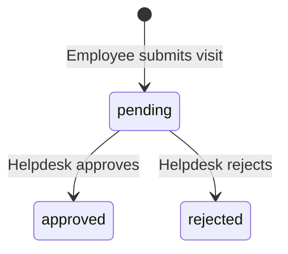

# Software Requirements Specification

MediCare Health Group · Implementation baseline: 2026-10-15

This specification describes the implemented React/Laravel MVP. [PRD](PRD.md) defines the product scope and [ERD](ERD.md) describes the database. Requirements below reflect current behavior; the final section identifies limitations and planned work.

## 1. System boundary and architecture

MediCare is a Third Party Administrator (TPA) medical benefits application serving client companies. Its browser interface is a React/TypeScript application. Laravel 13 exposes JSON APIs backed by MySQL and JWT authentication.

| Layer | Responsibility | Implementation |
| --- | --- | --- |
| Browser | Role pages, forms, feedback and record sorting | `frontend_react/src` |
| HTTP | Routing, authentication and JSON responses | Laravel routes, middleware and Controllers |
| Request validation | Validate fields and authorize write operations | FormRequests |
| Business operations | Scope company/owner queries, calculate benefits, submit and review visits | Services |
| Persistence | Relationships, password hashing and records | Eloquent Models and MySQL |
| API documentation | OpenAPI definitions and Swagger UI | L5 Swagger and PHP attributes |

The cloud frontend calls relative `/api` URLs on its own origin. A global external Application Load Balancer routes by hostname and path to the appropriate Cloud Run service. Cloud SQL, Artifact Registry and Cloud Run use `asia-east1`. See the [README deployment section](../README.md#gcp-deployment) for resource names and configuration.

## 2. Roles and authorization

| Capability | Employee | HR | Helpdesk |
| --- | --- | --- | --- |
| Sign in, read own profile and sign out | Yes | Yes | Yes |
| Employee benefits and personal visit UI | Own records | Not exposed in HR UI | Not exposed in Helpdesk UI |
| Submit a visit | Own identity only | Denied | Denied |
| List employees and benefit plans | Denied | Own company | Denied |
| View an employee's visits and medications | Own visit list | Employees in own company | Pending records through Helpdesk queue |
| Assign a current-year benefit plan | Denied | Employee and plan must belong to own company | Denied |
| List pending submissions and review them | Denied | Denied | All client companies |

Authorization is enforced by the backend, independently of browser navigation. HR requires a non-null company. Company-scoped employee/plan lookups return 404 when a requested record is outside that scope. Helpdesk is an internal TPA role; no per-company Helpdesk assignment mechanism exists.

`GET /api/visits` and `GET /api/benefits` require authentication and use the caller's own identity; these two read endpoints do not additionally restrict the caller's role to Employee. Their product interface is the Employee page. Write, HR and Helpdesk operations have explicit role checks.

## 3. Authentication and browser session

- **AUTH-01:** Login accepts `email` and `password`. Success returns `access_token` and `token_type: bearer`; invalid credentials return 401.
- **AUTH-02:** Protected API requests use `Authorization: Bearer <token>` and `Accept: application/json`.
- **AUTH-03:** `GET /api/me` returns `id`, `name`, `role` and `company_id` for the authenticated user.
- **AUTH-04:** The JWT configuration defaults to a 60-minute lifetime and enables token blacklisting. Runtime settings may override these defaults. No refresh-token API is exposed.
- **AUTH-05:** The browser stores the token in localStorage. It clears local state on sign out and sends the captured token to the logout endpoint for revocation. Non-401 revocation failures are reported to the user; a 401 response is treated as an already unusable token.
- **AUTH-06:** API client responses with status 401 clear the token and trigger the unauthorized-session flow.
- **AUTH-07:** The login route uses Laravel `throttle:5,1`. Requests exceeding the configured limiter receive 429.
- **AUTH-08:** Passwords are hashed; user JSON excludes password and remember-token fields. No registration or password-reset API is exposed by this MVP.

## 4. API interface

All application endpoints below are prefixed with `/api`. Protected operations require a valid JWT. Success responses use JSON; validation errors use Laravel's field-error structure.

| Method | Path | Request | Success response |
| --- | --- | --- | --- |
| POST | `/login` | `email`, `password` | 200: `access_token`, `token_type` |
| GET | `/me` | None | 200: current user profile |
| POST | `/logout` | None | 200: `message` |
| GET | `/benefits` | None | 200: current-year benefit summary |
| GET | `/visits` | None | 200: `{ visits: [...] }`, including medications |
| POST | `/visits` | Visit fields and optional medications | 201: `message`, `visit` |
| GET | `/hr/employees` | None | 200: `{ employees: [...] }` |
| GET | `/hr/benefit-plans` | None | 200: `{ benefit_plans: [...] }` |
| GET | `/hr/employees/{employeeId}/visits` | Numeric employee ID | 200: `employee`, `visits` including medications |
| POST | `/hr/benefit-assignments` | Integer `user_id`, `benefit_plan_id` | 200: `message`, `assignment` |
| GET | `/helpdesk/visits` | None | 200: pending `visits` with user, company and medications |
| PATCH | `/helpdesk/visits/{visitId}/status` | `status`: `approved` or `rejected` | 200: `message`, updated `visit` |

`GET /api/doc` serves Swagger UI, `/docs` serves the specification, and `/up` is the Laravel health endpoint. The backend nginx configuration also has `/ping` for its liveness probe; `/ping` is not routed to Laravel by the public load balancer.

### Error behavior

| Status | Meaning in this application |
| --- | --- |
| 401 | Missing/invalid/expired/revoked authentication, or invalid login credentials |
| 403 | Unauthorized role, HR without a company, or a benefit plan inconsistent with the user's company |
| 404 | Missing record, a record outside an HR-scoped lookup, or no current-year benefit assignment |
| 409 | An already processed visit is submitted for another review |
| 422 | Invalid request fields, medication subtotal above visit coverage, or attempted review of an ownerless visit |
| 429 | Login limiter exceeded |

## 5. Visit submission and medical details

### Input validation

| Field | Rule |
| --- | --- |
| `clinic` | Required string, maximum 255 characters |
| `visited_on` | Required valid date |
| `covered_amount` | Required whole TWD integer, 0 through 42,949,672 |
| `diagnosis` | Optional string, maximum 255 characters |
| `visited_time` | Optional `H:i` time; clinic local time without timezone conversion |
| `doctor_name`, `doctor_title` | Optional strings, maximum 255 characters each |
| `sick_leave_started_on`, `sick_leave_ended_on` | Optional `Y-m-d` dates; supplying either requires the other; end must be on/after start |
| `medications` | Optional array, maximum 50 items |
| Medication `name` | Required string, maximum 255 characters |
| Medication `dosage` | Optional string, maximum 255 characters |
| Medication `instructions` | Optional string, maximum 2,000 characters |
| Medication `covered_amount` | Required whole TWD integer, 0 through 42,949,672 |

- **VISIT-01:** The server assigns ownership from the authenticated Employee and sets initial status to `pending`. Client-supplied owner/status values cannot replace these assignments.
- **VISIT-02:** Medication items accept only `name`, `dosage`, `instructions` and `covered_amount`; a client cannot choose their `visit_id`.
- **VISIT-03:** Sum of medication covered amounts must not exceed the visit covered amount. Each amount is converted to integer cents before storage.
- **VISIT-04:** Visit and medication writes run in one transaction. Validation/business-rule failure must not leave partial records.
- **VISIT-05:** Personal visit and HR employee-visit queries return records ordered by visit date descending. React additionally offers ascending/descending client-side sorting across summary and medical-detail fields.
- **VISIT-06:** The interface identifies optional medical fields and explains that pending visits do not reduce the balance. No edit/delete visit endpoint is currently exposed.

## 6. Benefit plans and annual calculation

- **BENEFIT-01:** HR can select an Employee and an existing plan only within the HR user's company. The assignment year is the server's current year; the client does not choose the year.
- **BENEFIT-02:** Assigning a plan creates or updates the current-year assignment. Database uniqueness on `(user_id, year)` prevents multiple assignments for that year.
- **BENEFIT-03:** A benefit summary requires a current-year assignment. No assignment returns 404 and the browser displays the unassigned state.
- **BENEFIT-04:** The application timezone is UTC. Current-year assignment and usage calculations use the server's current calendar year; usage filters the visit's `visited_on` year.
- **BENEFIT-05:** `used_amount` is the sum of approved visit coverage in that year. Pending and rejected visits, other years and other users are excluded.
- **BENEFIT-06:** Medication amounts are included in visit coverage and are not summed again. Plan changes replace the annual limit while retaining usage derived from visits.
- **BENEFIT-07:** The summary returns `year`, `currency: TWD`, `plan_name`, `annual_limit`, `used_amount` and `remaining_balance` in whole TWD. Visit/plan list records expose their stored `_cents` fields; the browser converts them for display.
- **BENEFIT-08:** `remaining_balance = annual_limit - used_amount`. The current implementation does not prevent approval above the annual limit or clamp a negative balance. Over-limit processing is a future business-rule decision.

## 7. Helpdesk review

- **REVIEW-01:** The Helpdesk queue contains pending visits across all companies, ordered by creation time, with associated employee/company and medications.
- **REVIEW-02:** Review accepts only `approved` or `rejected`; approved/rejected records cannot be processed again through this endpoint.
- **REVIEW-03:** Review locks the visit row within a transaction, checks its current status, and saves the decision and audit fields together. Repeated processing returns 409.
- **REVIEW-04:** A visit with no owner cannot be reviewed and returns 422. The browser displays an employee-assignment message instead of review actions for such a record.
- **REVIEW-05:** `reviewed_by` and `reviewed_at` are generated from the authenticated reviewer and server time. Client input cannot choose audit identity or time.
- **REVIEW-06:** The browser asks for confirmation before sending a review decision. Reopening or reversing a completed review is outside the current API.

## 8. Data integrity and deployment requirements

The six domain entities, foreign keys, nullability and deletion restrictions are defined in [ERD](ERD.md). Company/role compatibility is enforced by application queries, not by composite foreign keys. Legacy ownerless visits and company-less users can exist in the schema; write/review authorization handles relevant cases explicitly.

| Area | Current implementation |
| --- | --- |
| Transport | HTTPS on both public domains with a Google-managed certificate; HTTP redirects to HTTPS |
| Network entry | All four Cloud Run services use Internal + Load Balancing ingress |
| Environment separation | Separate dev/prod databases, database users, runtime secrets and Cloud Run services; one shared Cloud SQL instance |
| Runtime configuration | `APP_ENV=production`, `APP_DEBUG=false`, environment-specific `APP_URL`; secrets supplied by Secret Manager |
| Authentication state | Database cache in cloud runtime supports shared JWT blacklist state across container instances |
| Images | Backend and frontend images published with full commit-SHA tags |
| Deployment order | Update/execute migration job and wait for success, then update backend, then frontend |
| Release gate | Protected `main` automatically publishes/deploys dev; manual prod job depends on dev success in the same pipeline |
| Data preservation | Deployment runs pending migrations, not automatic sample seeding or database reset |
| Serialization | Separate GitLab resource groups serialize dev and prod deployment jobs |

Current scaling settings are minimum 0, maximum 1 instance per service, with request-based billing. These are demonstration settings, not a measured capacity or availability guarantee. Database backup/restore drills, alerting and a rehearsed rollback procedure are follow-up operations work.

## 9. Verification and traceability

| Requirement area | Existing automated evidence |
| --- | --- |
| Self-owned visits and forged ownership/status | `EmployeeAuthorizationTest.php` |
| HR company visibility and role restriction | `HrAuthorizationTest.php` |
| Annual usage, ownership, missing assignment and medication accounting | `BenefitSummaryTest.php` |
| Medication validation, atomicity and reader scope | `VisitMedicationSubmissionTest.php` |
| Diagnosis, sick leave, visit time and doctor validation | `VisitMedicalDetailsTest.php` |
| Review roles, decision audit, terminal status and ownerless visits | `HelpdeskReviewTest.php` |
| Logout revocation and authentication | `AuthLogoutTest.php` |
| OpenAPI coverage and Swagger UI | `ApiDocumentationTest.php` |
| Removed legacy write routes | `LegacyVisitRoutesTest.php` |

Test files are under [`backend_laravel/tests/Feature`](../backend_laravel/tests/Feature). The suite uses SQLite in memory and an array cache. It does not establish MySQL lock behavior under concurrent requests or cloud performance. GitLab also runs frontend lint/build, PHP syntax checks, Composer validation and secret detection.

Manual cloud checks completed on 2026-10-14 include role login, Employee submission/approval, correct benefit deduction, HR company scope, HTTPS health, blocked direct service URLs, release execution and data preservation. See [README validation](../README.md#validation). This documentation update does not claim a new test run.

## 10. Known limits and planned work

- Automated cases for HR assignment creation/switching and login failure/limiter behavior are follow-up coverage; existing manual checks must not be reported as those automated tests.
- Lists currently return complete collections. API pagination, server-side search/filtering and a reviewed growth/indexing plan are future work.
- Helpdesk has a pending queue, with no dedicated processed-review history endpoint or rejection-reason field.
- No self-service registration, password reset, user/plan administration UI, attachment upload, notifications, aggregate HR dashboard, guarantee letters or panel-network administration is implemented.
- Public demonstration accounts operate on fictional, shared data. The prod environment provides the stable demonstration release.

## 11. Implementation sources

- [API routes](../backend_laravel/routes/api.php)
- [Request validation](../backend_laravel/app/Http/Requests)
- [Business services](../backend_laravel/app/Services)
- [Models](../backend_laravel/app/Models)
- [Migrations](../backend_laravel/database/migrations)
- [Frontend API clients](../frontend_react/src/services/api)
- [Release pipeline](../.gitlab-ci.yml)
